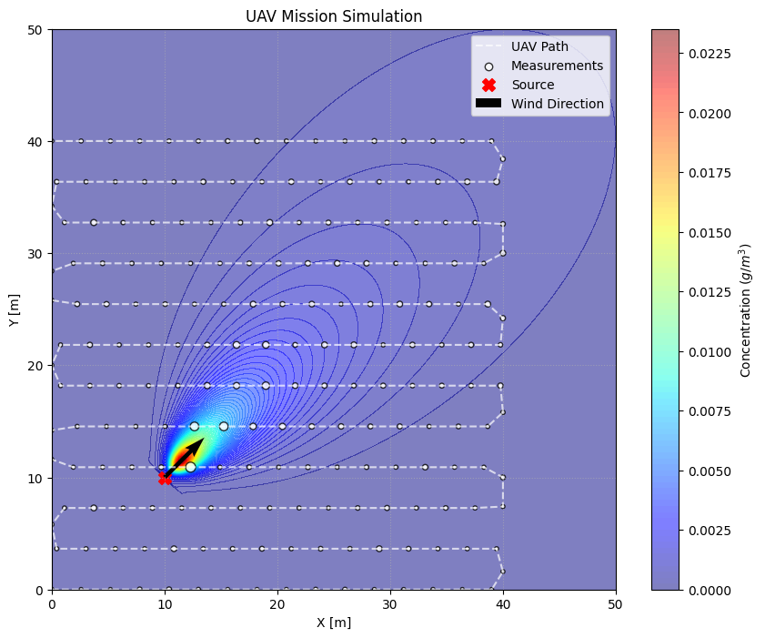
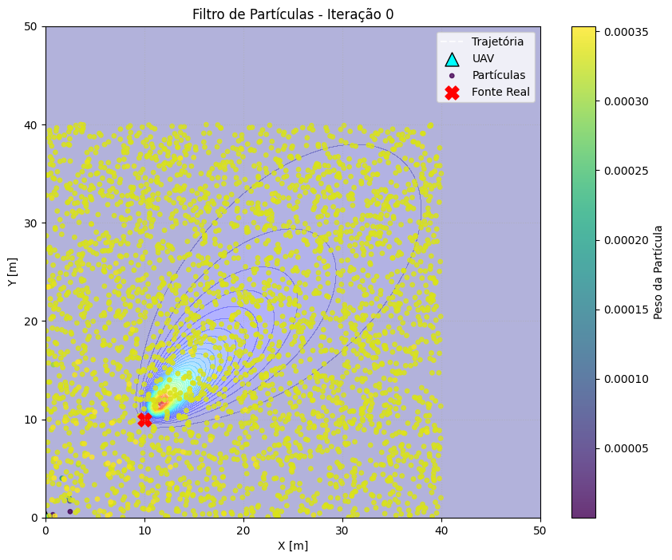
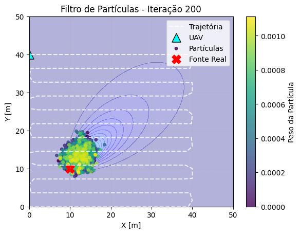
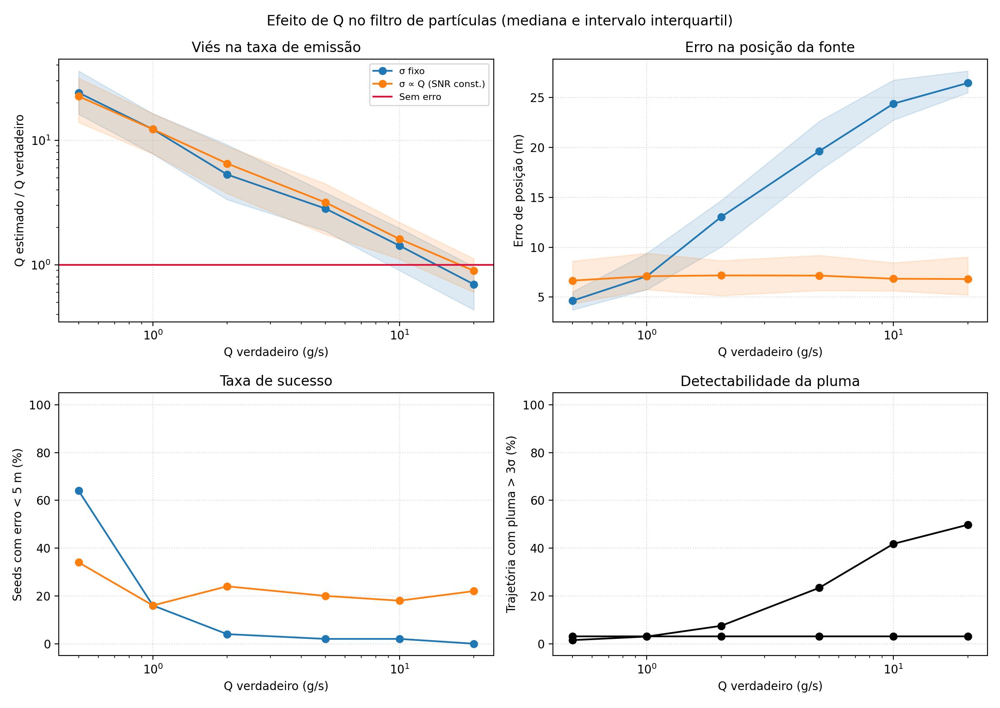

# Estimação da fonte de fumaça de incêndios florestais com drones

Onde está o foco do incêndio, e quanto ele emite? Este projeto simula um drone (UAV) que sobrevoa uma área medindo a concentração de gás e usa **inferência bayesiana com Monte Carlo sequencial (filtro de partículas)** para estimar, a cada nova medição, a posição da fonte e a sua taxa de emissão.

Projeto de Iniciação Científica na Universidade de São Paulo, apresentado no SIICUSP 2026.

<p align="center">
  
</p>

## O problema

Em um incêndio florestal, a fumaça se espalha com o vento e esconde a origem do fogo. Este problema é conhecido como *Source Term Estimation* (STE): a partir de medições pontuais de concentração, inferir os parâmetros da fonte (posição, taxa de emissão Q) e do ambiente (direção e velocidade do vento, dispersão).

## Como funciona

1. **Modelo físico:** a pluma é descrita por um modelo de pluma gaussiana, que dá a concentração esperada em qualquer ponto dado um conjunto de parâmetros da fonte e do vento.
2. **Medições:** o drone percorre uma trajetória de varredura e lê um sensor de gás com ruído.
3. **Filtro de partículas:** milhares de hipóteses (partículas) sobre a fonte são sorteadas da distribuição *a priori*. A cada medição, cada partícula recebe um peso pela verossimilhança (gaussiana) da leitura observada.
4. **Reamostragem:** quando o número efetivo de partículas cai abaixo de um limiar, as partículas são reamostradas (reamostragem sistemática com *roughening*) para concentrar o esforço nas hipóteses mais prováveis.
5. **Estimativa:** a nuvem final de partículas aproxima a distribuição *a posteriori* da posição da fonte e de Q.

| Início: partículas espalhadas pela área | Após 200 iterações: partículas concentradas perto da fonte |
| :---: | :---: |
|  |  |

## Resultados: como a taxa de emissão Q afeta o filtro?

Para responder a essa pergunta, rodei o filtro em **6 valores de Q** (0,5 a 20 g/s), com **50 sementes aleatórias** por cenário, medindo o erro de posição, o viés na estimativa de Q e a taxa de sucesso (erro < 5 m).

| Q verdadeiro (g/s) | Erro de posição mediano, ruído fixo | Erro de posição mediano, razão sinal-ruído constante |
| ---: | ---: | ---: |
| 0,5 | 4,6 m | 6,7 m |
| 1 | 7,1 m | 7,1 m |
| 2 | 13,0 m | 7,2 m |
| 5 | 19,6 m | 7,2 m |
| 10 | 24,4 m | 6,8 m |
| 20 | 26,5 m | 6,8 m |

Com ruído de sensor fixo, o erro de posição **cresce** com Q, embora a pluma fique mais fácil de detectar. Quando o ruído cresce junto com Q (razão sinal-ruído constante), o erro fica estável em torno de 7 m. Aumentar 10 vezes o número de partículas com Q = 10 quase não ajuda (26,0 m → 23,4 m).

Esses resultados indicam que, com sinal forte, a verossimilhança fica concentrada demais: poucas partículas recebem quase todo o peso e o filtro deixa de explorar o espaço de parâmetros. É um caso de **degeneração dos pesos**, e não de falta de informação nas medições.

<p align="center">
  
</p>

Outros experimentos estão no notebook: cenários com vento forte e fonte distante, efeito da altura da fonte assumida pelo filtro e uma versão com os parâmetros do modelo bem especificados.

## Estrutura

```
src/
  DispersionModels.py    modelo de pluma gaussiana
  Sensors.py             sensores de gás com ruído
  MovementStrategies.py  trajetórias do drone (varredura)
  SimulationClasses.py   mundo, drone e histórico de medições
  Likelihood.py          verossimilhança gaussiana
  Resample.py            reamostragem sistemática com roughening
  Estimators.py          interface comum dos estimadores
  ParticleFilter.py      filtro de partículas
  Visualization.py       gráficos da missão e da posterior
  experiments.py         execução de vários cenários e sementes
  q_study.py             estudo do efeito de Q
notebooks/
  main.ipynb             simulação principal e todos os experimentos
  resultados/            figuras geradas
```

Os módulos são independentes: o modelo de dispersão, a verossimilhança e a reamostragem são injetados no filtro pela configuração, o que permite trocar qualquer um deles sem mexer no resto.

## Como rodar

```bash
pip install -r requirements.txt
cd notebooks
jupyter notebook main.ipynb
```

Ou, com Docker:

```bash
docker compose up
```

e abra `http://localhost:8888`.

Para rodar um experimento direto em Python, a partir da pasta `src/`:

```python
from experiments import run_experiments, summarize

results = run_experiments({"base": {}, "vento_forte": {"u": 10.0}}, seeds=range(20))
summarize(results)
```

## Limitações e próximos passos

- O filtro ainda não tem uma etapa explícita de predição (passeio aleatório das partículas entre medições), o que deve ajudar na degeneração observada com Q alto.
- Adaptar o modelo para frentes de incêndio dinâmicas, em que a fonte se move ao longo do tempo.
- Testar estratégias de movimento adaptativas, em que o drone escolhe o próximo ponto com base na incerteza atual.

## Créditos

Este repositório é um fork do projeto [UAVs_forest_fires_STE](https://github.com/CarlosCraveiro/UAVs_forest_fires_STE), criado por Carlos Craveiro, que estruturou a base do simulador e do filtro de partículas.

Orientação: Prof. Dr. Glauco Augusto de Paula Caurin (EESC-USP).

Referências principais: Hutchinson, Oh e Chen (2017, 2019); Burgués e Marco (2020); Thrun, Burgard e Fox (2005).

Licença MIT.
